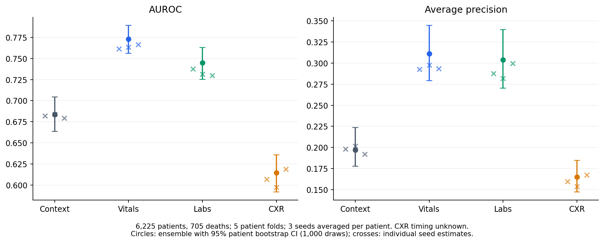
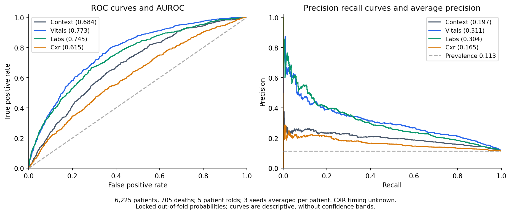
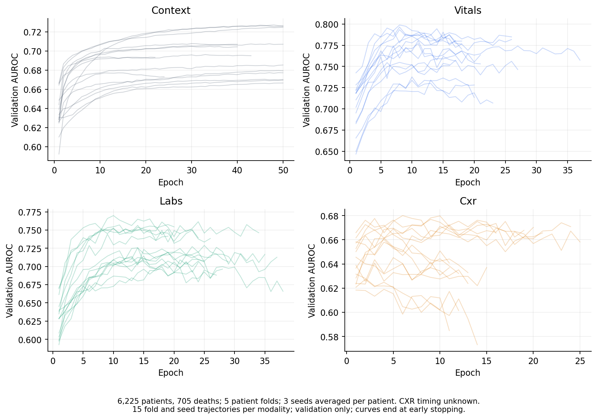
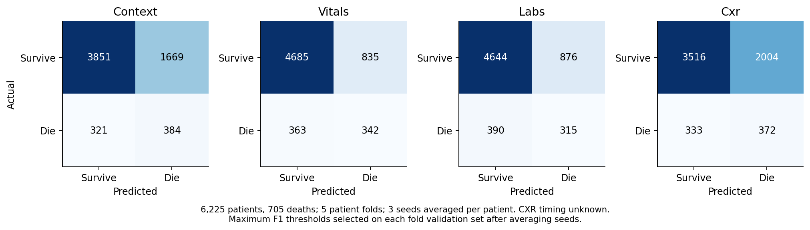

# Evaluation of E2 Unimodal Encoders

Evaluation date 21 October 2026. This document evaluates the four independently trained E2 encoders before fusion. All 60 planned fits completed. Vitals have the strongest unimodal AUROC point estimate, while the CXR encoder adds no statistically resolved AUROC improvement over its logistic baseline. The results support proceeding to fixed fusion experiments without an encoder architecture sweep.

## Background

The project asks which clinical modalities contribute to in-hospital mortality prediction among adults alive and still in ICU at a 48-hour landmark. E1 established fixed logistic and LightGBM reference models; E2 replaces each modality’s summary classifier with a learned 128-dimensional representation. These representations will initialize the E3 and E4 fusion models.

The final matched cohort contains 6,225 patients and 705 in-hospital deaths, a prevalence of 11.33%. Each patient contributes one first ICU stay. EHR observations are restricted to the first 48 hours. Chest X-rays lack timing metadata, so their results are exploratory associations rather than evidence of prospective availability at the landmark. Report text is excluded.

| Modality | Ensemble AUROC with 95% CI | Average precision |
| --- | --- | --- |
| Context | 0.684 (0.664–0.704) | 0.197 |
| Vitals | 0.773 (0.756–0.789) | 0.311 |
| Labs | 0.745 (0.725–0.763) | 0.304 |
| CXR | 0.615 (0.592–0.636) | 0.165 |

### Scope of this evaluation

The primary display averages the three prespecified seed probabilities for each patient; it does not select the best seed. Individual seed scores and fold dispersion are also reported. Comparisons use the same patients and fixed folds as E1. A unimodal ranking does not establish the incremental contribution of a modality in fusion.

Training job 215538 completed on one NVIDIA L40S in 15 minutes 44 seconds, following a 19-second GPU smoke test. Evaluation job 217724 completed on CPU in 1 minute 22 seconds after 46 tests passed. There were no new prespecified leakage-gate failures. The existing missingness warning remains active.

## Detailed Experiment Methodology

### Cohort and partitioning

Starting from MIMIC-IV 2.1 and the supplied Kaggle CXR metadata, the pipeline selects adult first ICU stays, excludes inconsistent outcome metadata, and requires ICU residence and survival through hour 48. The selected frontal image must resolve uniquely and decode. Eligible stays require valid heart-rate and numeric laboratory observations. Final value QC removed no additional eligible stays.

Five StratifiedGroupKFold outer folds are persisted with seed 42. There is one stay per patient and zero patient overlap within a fold’s training, validation and test partitions. Fifteen percent of the four-fold development portion is reserved for stratified inner validation, using seed 42 plus the fold number. No outer test patient contributes to preprocessing, checkpoint or threshold selection. Outer-fold death counts are 136, 158, 125, 141 and 145.

### Inputs and preprocessing

| Stream | Input construction |
| --- | --- |
| Context | Age standardized on inner training patients; binary sex; training-only one-hot admission type and first care unit, with explicit unknown categories. Input width follows the fitted vocabulary rather than a hard-coded 20. |
| Vitals | 48 hourly bins × 16 channels: 8 normalized values and 8 observation masks. Values: heart rate, respiratory rate, SpO2, systolic/diastolic/mean blood pressure, temperature and total GCS. |
| Labs | 48 hourly bins × 22 channels: 11 normalized values and 11 masks. Glucose, pH, hemoglobin, white blood cells, platelets, creatinine, BUN, sodium, potassium, bicarbonate and lactate. |
| CXR | 49 × 1,024 frozen spatial DenseNet features. First listed AP image, otherwise first PA; no substitute if the selected file is missing. Grayscale, short side 224, center crop 224 and intensity scaling to [−1,024, 1,024]. |

For EHR, use observations in [ICU admission, admission plus 48 hours), hourly means, fixed unit conversion and broad artifact bounds in configs/features.yaml. GCS is assembled only when all three valid components occur within the same hour; ETT verbal responses are unassessable. Standardization statistics use observed inner-training values only. Forward fill stays within the patient window; leading gaps use the training mean.

CXR features come from frozen torchxrayvision densenet121-res224-chex weights trained on CheXpert. The image backbone is not fine-tuned in E2. No PCA is used in E2; E1’s image comparator uses pooled features and training-fold PCA to 64 dimensions. Thus comparisons include representation and learner differences.

## Detailed Experiment Methodology

### Fixed encoder architectures

| Encoder | Architecture | Output before pooling |
| --- | --- | --- |
| Context | MLP: input → 64 → 128; ReLU and dropout 0.1 between linear layers. | 1 × 128 |
| Vitals | Linear 16 → 128; sinusoidal positions; 2 Transformer encoder layers; 4 heads; feed-forward width 256; dropout 0.1. | 48 × 128 |
| Labs | Linear 22 → 128; otherwise the same temporal architecture as vitals. | 48 × 128 |
| CXR | Linear 1,024 → 128; learned spatial positions; 1 Transformer encoder layer; 4 heads; feed-forward width 256; dropout 0.1. | 49 × 128 |

Each model applies masked mean pooling followed by a single 128-to-1 linear mortality head. A temporal hour is pooled only if at least one channel was observed. All context/image tokens are valid. Temporal self-attention has no observation key-padding mask: it can attend to imputed tokens, although entirely unobserved hours are excluded from the final pool. Masks are also explicit input channels. This is the implemented E2 method, not an assumption of complete missingness invariance.

| Training choice | Fixed value |
| --- | --- |
| Runs | 4 modalities × 5 folds × seeds 0, 1 and 2 = 60 |
| Objective | BCE with logits; positive weight = training negatives / training positives |
| Optimizer | AdamW; learning rate 0.0001; weight decay 0.01 |
| Batch and precision | Batch size 64; bf16 autocast; gradient norm clipped at 1.0 |
| Selection | At most 50 epochs; patience 10; checkpoint with highest inner-validation AUROC |
| Inference | Best selected checkpoint; sigmoid probabilities; no test-based epoch or seed selection |
| Resume | Per-epoch model, optimizer and RNG checkpoints; separate sampler/worker generators; saved per-fold encoders |

### Evaluation and uncertainty

For each modality, average corresponding seed probabilities before patient bootstrapping. Ensemble thresholds are selected on the similarly averaged validation predictions within each fold, then applied unchanged to that fold’s test patients. The main operating point maximizes validation F1, breaking ties at the highest threshold. Separate thresholds target validation recall of 0.80 and 0.90; actual test recall is reported without assuming those targets generalize.

AUROC measures ranking; AUPRC is average precision, with a cohort prevalence reference of 0.113. The 95% intervals use 1,000 patient bootstrap draws, seed 42. Paired E2-minus-E1 differences share resampled patients. Intervals are conditional on the trained models and exclude uncertainty from retraining, alternate splits and external sites. Comparisons are descriptive and not multiplicity-adjusted. Three seed copies are never counted as three independent patients.

## Results and Discussion

### Discrimination and seed stability

| Modality | Seed AUROCs 0  1  2 | Mean ± SD across seeds | Ensemble AP with 95% CI |
| --- | --- | --- | --- |
| Context | 0.682 / 0.684 / 0.679 | 0.682 ± 0.002 | 0.197 (0.178–0.224) |
| Vitals | 0.762 / 0.763 / 0.767 | 0.764 ± 0.003 | 0.311 (0.279–0.345) |
| Labs | 0.738 / 0.732 / 0.730 | 0.733 ± 0.004 | 0.304 (0.270–0.340) |
| CXR | 0.607 / 0.597 / 0.619 | 0.607 ± 0.011 | 0.165 (0.147–0.185) |

Vitals have the highest ensemble AUROC point estimate, followed by labs, context and CXR. Vitals and labs have similar average-precision point estimates with overlapping patient intervals. These are descriptive rankings: the analysis does not include a paired vitals-versus-labs significance test and does not establish which modality adds the most information after conditioning on the others.

Averaging seeds improves the vitals and labs point estimates relative to each individual run. CXR shows the largest seed-to-seed AUROC spread. Seed standard deviations describe optimization sensitivity on these fixed folds; they are not patient confidence intervals or evidence of external generalization.

## Results and Discussion

### Comparison with E1 counterparts

| Modality | E1 comparator | Delta AUROC with 95% CI | Delta AP with 95% CI |
| --- | --- | --- | --- |
| Context | Logistic | +0.002 (-0.002 to +0.007) | +0.007 (-0.001 to +0.016) |
| Context | LightGBM | +0.022 (+0.013 to +0.031) | +0.012 (+0.003 to +0.022) |
| Vitals | Logistic + counts | +0.001 (-0.012 to +0.015) | -0.014 (-0.036 to +0.010) |
| Vitals | LightGBM + counts | +0.004 (-0.007 to +0.017) | +0.005 (-0.020 to +0.031) |
| Labs | Logistic + counts | +0.003 (-0.013 to +0.019) | -0.013 (-0.036 to +0.014) |
| Labs | LightGBM + counts | -0.007 (-0.022 to +0.010) | -0.012 (-0.038 to +0.014) |
| CXR | Logistic | +0.009 (-0.005 to +0.022) | +0.003 (-0.007 to +0.014) |
| CXR | LightGBM | +0.046 (+0.025 to +0.065) | +0.020 (+0.004 to +0.037) |

E2 is not clearly worse than its relevant E1 counterpart. In particular, the vitals and labs AUROC intervals against count-aware tabular comparators include zero. E2 improves some no-count reference models, but E2 itself contains observation masks, so this cannot be attributed solely to temporal architecture. CXR improves over LightGBM, while its difference from logistic regression is unresolved. Context is also unresolved against logistic regression. There is no evidence here to justify an encoder architecture sweep.

The table compares a three-seed E2 ensemble with the fixed seed-0 E1 model, not equal-sized ensembles of identical representations. Count-aware E1 models are emphasized because E2 explicitly receives masks. Full comparisons, including both count variants, are retained in E2Comparisons.csv. These comparisons do not show a multimodal gain; E2 models each modality independently.

## Results and Discussion

### Training behavior and execution

| Modality | Selected epoch median range | Trained epochs median range | Fold and seed AUROC mean ± SD |
| --- | --- | --- | --- |
| Context | 47 [12–50] | 50 [22–50] | 0.688 ± 0.048 |
| Vitals | 10 [6–27] | 20 [16–37] | 0.767 ± 0.021 |
| Labs | 16 [9–28] | 26 [19–38] | 0.742 ± 0.015 |
| CXR | 4 [1–15] | 14 [11–25] | 0.622 ± 0.019 |

Context improves gradually, with some runs reaching the 50-epoch cap. Temporal models improve quickly before noisier validation plateaus; the CXR runs stop relatively early. The highest validation checkpoint, rather than the final epoch, supplies test predictions. Early stopping limits unnecessary computation without choosing among architectures. Fold-and-seed SD is descriptive because the 15 fits share patients and overlapping training sets.

All fits completed within 15 minutes 44 seconds on a single L40S. CPU aggregation took 1 minute 22 seconds. The quick runtime reflects the small cohort, frozen image backbone, cached features and early stopping; it is not an estimate for larger cohorts or end-to-end image fine-tuning.

## Results and Discussion

### Operating points and error patterns

| Modality | Precision | Recall | F1 | Specificity |
| --- | --- | --- | --- | --- |
| Context | 0.187 | 0.545 | 0.278 | 0.698 |
| Vitals | 0.291 | 0.485 | 0.363 | 0.849 |
| Labs | 0.264 | 0.447 | 0.332 | 0.841 |
| CXR | 0.157 | 0.528 | 0.241 | 0.637 |

| Modality | Target 80 test precision recall | Target 90 test precision recall |
| --- | --- | --- |
| Context | 0.163 / 0.763 | 0.144 / 0.899 |
| Vitals | 0.210 / 0.791 | 0.175 / 0.892 |
| Labs | 0.188 / 0.801 | 0.158 / 0.885 |
| CXR | 0.141 / 0.759 | 0.129 / 0.864 |

Recall targets refer to validation, while the table gives the resulting test precision and recall. None of these operating points has been selected for clinical deployment. With 11.33% mortality prevalence, false positives remain substantial even when discrimination exceeds chance. Maximum F1 prioritizes a particular precision–recall trade-off and is not a clinical utility assessment. Calibration and decision-curve analysis were outside this experiment.

### Limits that govern interpretation

The cohort is selected by a surviving 48-hour ICU landmark and available CXR, so results do not cover early deaths, earlier discharges or all ICU patients. It is a single-center retrospective sample. Unknown image timing may introduce future or cross-admission information. The final mask-only LightGBM AUROC remains 0.687, above the 0.65 warning threshold; measurement intensity may carry severity or care-process information. Neither moderate scores nor a passing shuffled-label canary proves absence of leakage. Clinical usefulness requires separate prospective, temporal and external validation.

## Conclusion

E2 is technically complete: 60 fits, saved fold-specific encoders and 12 complete seed-by-modality out-of-fold prediction files. Vitals and labs provide the strongest unimodal discrimination in this analysis. The corresponding ensemble AUROCs are 0.773 and 0.745; context is 0.684 and untimed CXR is 0.615. These estimates are compatible with the count-aware tabular counterparts and do not motivate an architecture search.

The results establish reusable unimodal starting points, not a fusion benefit. They support the next fixed experiments while preserving the E1 reference models, locked folds, train-only preprocessing, active missingness warning and CXR timing caveat.

## Next steps

Proceed with E3 early fusion: concatenate the four pooled 128-dimensional E2 representations, freeze the encoders and train a 512-to-128-to-1 MLP. Then use the same head with the E2 encoders fine-tuned jointly. Run all five folds and three seeds with the same fixed training settings, validation-only checkpoint/threshold selection and protected outer tests. The CheXpert DenseNet image backbone remains frozen; joint training concerns the E2 encoders above it.

Add an unweighted average of E2 probabilities as a low-cost late-fusion reference. Logistic stacking is lower priority: its fitting and threshold selection need separate validation roles or a training-only cross-fitting design. Do not silently train and assess a stacker on the same validation predictions. The optional MedFuse-style LSTM remains lowest priority.

After E3, compare paired patient AUROC and average-precision differences against E1 EHR, E1 all modalities and the late-fusion reference. Follow with E4 cross-attention and E5 masking/leave-one-out experiments to test incremental contribution and robustness. A unimodal rank or attention weight alone will not be presented as modality importance.

### Reproducibility and evidence

| Evidence | Location or identifier |
| --- | --- |
| Training | Slurm 215538; source 0f6bd8d; E2 completion signature e1ed74ed723d556a3dc05899eba2b92423e2fa3162377bc3dd25e1bf9fcc0c23 |
| Evaluation | Slurm 217724; source 27f9b56; 46 tests passed; evaluate_e2.py and scripts/slurm/evaluate_e2.sbatch |
| Private model artifacts | /projects/icumultimodal/results/deep/e2 and results/oof; patient predictions stay on the cluster |
| Aggregate evidence | results/evaluation/e2/summary.csv, comparisons.csv, fold_metrics.csv, learning_curves.csv and metadata.json |
| Figures | /projects/icumultimodal/reports/figures/e2; copied alongside this document |
| Protocol and environment | docs/PROTOCOL.md; configs/features.yaml; requirements.txt; results/setup/pipfreeze.txt and condaexplicit.txt |

Every reported numerical result traces to the locked training/evaluation artifacts above. Exported CSVs and figures contain aggregate information only. No patient rows, images, report text, identifiers or predictions were used in this document authoring session.
